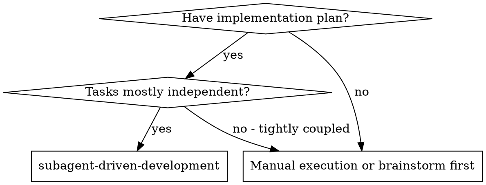
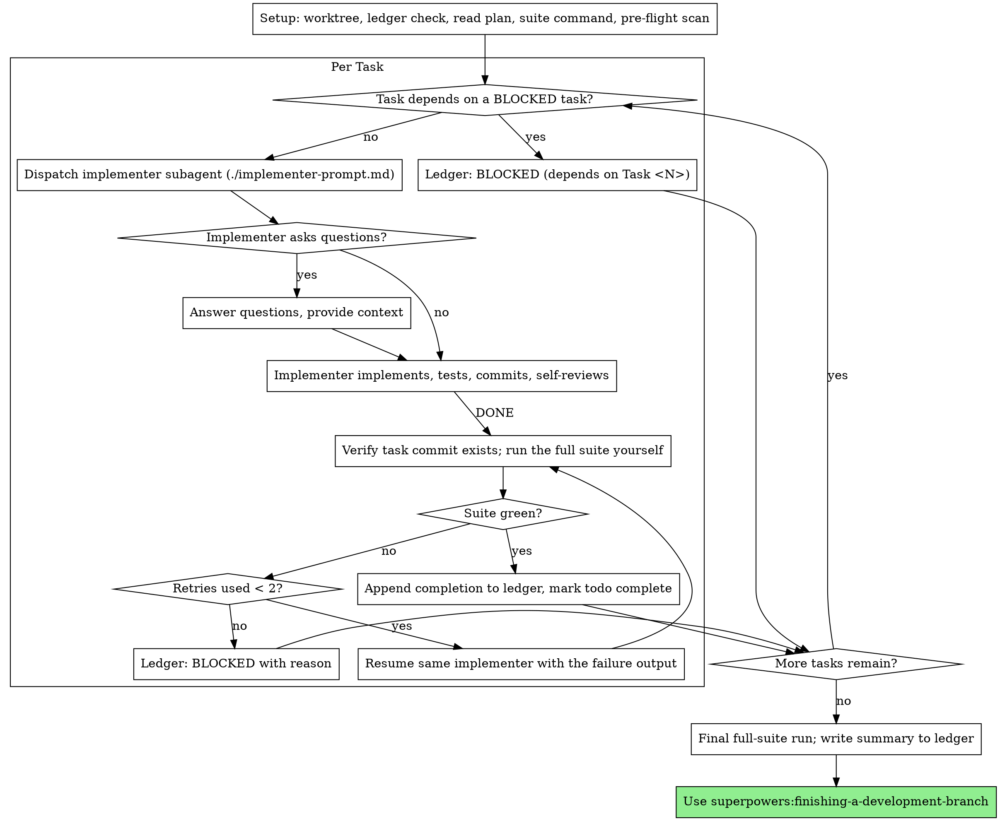

# Subagent-Driven Development

Execute plan by dispatching a fresh implementer subagent per task, verifying each task yourself by running the full test suite after it, and running the full suite once more at the end.

**Why subagents:** You delegate tasks to specialized agents with isolated context. By precisely crafting their instructions and context, you ensure they stay focused and succeed at their task. They should never inherit your session's context or history — you construct exactly what they need. This also preserves your own context for coordination work.

**Core principle:** Fresh subagent per task + full suite run by you after each task + final full-suite run = verified progress, fast iteration

**Narration:** between tool calls, narrate at most one short line — the
ledger and the tool results carry the record.

**Continuous execution:** Do not pause to check in with your human partner between tasks. Execute all tasks from the plan without stopping. The only reasons to stop are the four named below, or all tasks complete. "Should I continue?" prompts and progress summaries waste their time — they asked you to execute the plan, so execute it.

**Rulings, not stalls.** A running plan does not wait on a human. Conflicts,
ambiguities, plan defects, a cap you would have asked to exceed — decide
them. The spec is the binding authority, the plan is its argument, and your
judgment settles what neither answers. Record every decision in the ledger as
`Ruling: <what you decided> — <why> — <what it costs if wrong>`, and keep
going. A wrong ruling costs rework your human partner can see and undo; a
session parked on a question costs their whole day and buys nothing.

Four things stop you, and only these: an irreversible or destructive
operation; a security-sensitive action; a side effect outside this worktree
that norms say you ask about first (a merge, a push to a shared branch, a
publish); and a plan so broken that every path forward is a guess. For those,
stop and ask.

## When to Use

## The Process

## Setup

Ensure the work happens in an isolated workspace: use
superpowers:using-git-worktrees to create one or verify the existing one.
Never start implementation on a main/master branch without your human
partner's explicit consent.

Conversation memory does not survive compaction. In real sessions,
controllers that lost their place have re-dispatched entire completed task
sequences — the single most expensive failure observed. Track progress in
a ledger file, not only in todos.

- Each plan owns a workspace: at skill start, run this skill's
  `bash scripts/sdd-workspace PLAN_FILE` by its absolute path, from the
  working tree you're executing in — it prints the plan's git-ignored
  directory (under `<repo-root>/.superpowers/sdd/`), home to
  every artifact for THIS plan: ledger, briefs, reports, suite-run outputs.
  Another plan's directory is never yours to read or write.
- Check for this plan's ledger at `<workspace>/progress.md`. If one exists,
  read [references/resuming.md](references/resuming.md) before anything
  else: it says whose ledger it is and where to resume.
- Create the ledger with its identity as the first line:
  `# SDD ledger — plan: <plan file path>`.
- The ledger is your recovery map: the commits it names exist in git even
  when your context no longer remembers creating them. After compaction,
  trust the ledger and `git log` over your own recollection.
- `git clean -fdx` will destroy the workspace (it's git-ignored scratch); if
  that happens, recover from `git log`.

Read the plan once, note its context and Global Constraints, and create a
todo per task. If the plan names a Spec, read that too: the spec is the
authority the plan argues from, and conflicts inside the plan resolve
against it. A plan with no reachable spec gets a ledger note saying so —
rulings made without one are provisional.

Identify the single command that runs the project's entire test suite (from
the plan's Global Constraints or verification steps, otherwise from the
project's own configuration) and write it in the ledger as
`Suite: <command>`. Run it once before Task 1 and record the baseline
(`Baseline: <passed>/<total>, failing: <test ids or "none">`). If the
command is ambiguous, rule on it and ledger the ruling.

Before dispatching Task 1, read [references/preflight.md](references/preflight.md)
and run the conflict scan it describes. Its table and rulings go in the
ledger. The scan also records, for each task, which earlier tasks it
depends on (its Interfaces "Consumes" block, plus any file or interface it
shares with an earlier task): write it as `Task <N> depends on: <task
numbers or "none">`. Those lines decide what a BLOCKED task takes down with
it.

## Model Selection

Use the least powerful model that can handle each role to conserve cost and increase speed.

**Mechanical implementation tasks** (isolated functions, clear specs, 1-2 files): use a fast, cheap model. Most implementation tasks are mechanical when the plan is well-specified.

**Integration and judgment tasks** (multi-file coordination, pattern matching, debugging): use a standard model.

**Architecture and design tasks**: use the most capable available model.

**Always specify the model explicitly when dispatching a subagent.** An
omitted model inherits your session's model — often the most capable and
most expensive — which silently defeats this section.

**Turn count beats token price.** Wall-clock and context cost scale with how
many turns a subagent takes, and the cheapest models routinely take 2-3× the
turns on multi-step work — costing more overall. Use a mid-tier model as the
floor for implementers working from prose descriptions.
When the task's plan text contains the complete code to write, the
implementation is transcription plus testing: use the cheapest tier for
that implementer. Single-file mechanical fixes also take the cheapest tier.

**Task complexity signals (implementation tasks):**
- Touches 1-2 files with a complete spec → cheap model
- Touches multiple files with integration concerns → standard model
- Requires design judgment or broad codebase understanding → most capable model

## The Task Loop

**Small same-shape work:** when the plan lists several small edits of the
same kind across files, read [references/batching.md](references/batching.md)
before dispatching them.

Everything you paste into a dispatch prompt — and everything a subagent
prints back — stays resident in your context for the rest of the session
and is re-read on every later turn. Hand artifacts over as files.

**Waiting on dispatched subagents:** never poll a wait interface with
short timeouts, and never sit in one silent, open-ended wait either.
While you have local work — ledger updates, preparing the next brief,
reading reports — keep working; child results arrive on their own.
When you are genuinely idle, wait in bounded stretches (five to ten
minutes, where your platform allows), and between stretches post one
line of status and reconcile your live children: list them, and chase
any that finished without reporting. A bounded stretch keeps nearly
all of a long wait's efficiency while guaranteeing a stuck or lost
child is noticed within minutes, not at the end of the session.

### 0. Check dependencies

Before dispatching a task, check its `depends on` line in the ledger. If it
depends on a task marked BLOCKED — directly or through another blocked
task — do not dispatch it. Append
`Task <N>: BLOCKED — depends on Task <M> (blocked)` to the ledger, mark its
todo accordingly, and move on to the next task.

### 1. Dispatch the implementer

Record BASE (`git rev-parse HEAD`) before dispatching — you need it to
verify the task's commits.

- **Task brief:** before dispatching an implementer, run this skill's
  `bash scripts/task-brief PLAN_FILE N` by its absolute path, from the
  working tree you're executing in — it extracts the task's full text to a
  uniquely named file and prints the path. Compose the dispatch so the
  brief stays the single source of
  requirements. Your dispatch should contain: (1) one line on where this
  task fits in the project; (2) the brief path, introduced as "read this
  first — it is your requirements, with the exact values to use verbatim";
  (3) interfaces and decisions from earlier tasks that the brief cannot
  know; (4) your resolution of any ambiguity you noticed in the brief;
  (5) the report-file path and report contract. Exact values (numbers,
  magic strings, signatures, test cases) appear only in the brief. Never
  make a subagent read the whole plan file.
- **Report file:** name the implementer's report file after the brief
  (brief `…/task-N-brief.md` → report `…/task-N-report.md`) and put it in
  the dispatch prompt. The implementer writes the full report there and
  returns only status, commits, a one-line test summary, and concerns.
- A dispatch prompt describes one task, not the session's history. Do not
  paste accumulated prior-task summaries ("state after Tasks 1-3") into
  later dispatches — a real session's dispatch hit 42k chars of which 99%
  was pasted history. A fresh subagent needs its task, the interfaces it
  touches, and the global constraints. Nothing else.
- The dispatch carries the no-subagents contract (it is in the
  implementer template): the implementer never dispatches subagents —
  not helpers, and not reviewers. Verification arrives from you, after
  the report: you check the commit and run the full suite yourself.
- If an earlier task is BLOCKED, tell the implementer which suite failures
  are already known and belong to that task (point to its ledger entry), so
  it neither chases them nor mistakes them for its own.
- Record the implementer's agent identity from the dispatch result —
  red-suite retries resume this agent.
- Never dispatch multiple implementation subagents in parallel (conflicts).

Template: [implementer-prompt.md](implementer-prompt.md)

### 2. Handle the report

Implementer subagents report one of four statuses. Handle each appropriately:

**DONE:** go straight to step 3 and verify the task yourself.

**Any other status** (DONE_WITH_CONCERNS, NEEDS_CONTEXT, BLOCKED): read
[references/handling-reports.md](references/handling-reports.md) and follow
it, every time you get one.

If the implementer asks questions — before starting or mid-task — answer
clearly and completely, provide additional context if needed, and don't
rush it into implementation.

### 3. Verify the task

The implementer's report is a claim, not evidence. Verify it yourself:

1. **The commit exists.** `git log --oneline BASE..HEAD` must list the
   commits the implementer reported, and they must be on the branch you
   are executing in. No commit, or a reported SHA that is not in that
   range, means the task is not done: treat it as a red suite (step 4) and
   name the missing commit as the failure.
2. **Run the entire suite yourself** with the `Suite:` command from the
   ledger — the whole suite, never only the tests the implementer named,
   and never trusting the report's test summary. Redirect the output to
   `<workspace>/task-<N>-suite-<R>.txt` (R = 0 for the first run, then the
   retry number) and read only its summary and failures.
3. **Judge the result.** The suite is green when every test passes, or when
   the only failures are ones already recorded against BLOCKED tasks in
   the ledger. Any other failure, error, or a suite that cannot run is red.

### 4. Red suite: retry, then block

If the suite is red, resume the **same implementer** (the agent identity
you recorded) with the path of the failure-output file and the failing
test ids, and ask it to fix the cause, re-run the suite, commit, and
append a fix report to its report file. Then repeat step 3.

At most **2 retries** per task. Append one line per retry:
`Task <N>: suite red, retry <R>/2 — <failing tests one-liner>`

If the suite is still red after the second retry, stop retrying. Append:
`Task <N>: BLOCKED — <reason: what fails and why, as far as you can tell> — failing: <test ids> (commits <base7>..<head7>)`

Mark its todo as blocked and move on. Every task that depends on it stays
blocked (step 0); tasks that do not depend on it continue as normal.

Never fix the failure yourself in the controller session — your context
stays clean for coordination, and controller fixes skip the implementer's
TDD.

### 5. Complete the task

When the suite comes back green, append the completion line to the ledger
in the same message as your other bookkeeping:

- `Task <N>: complete (commits <base7>..<head7>, suite green <passed>/<total>)`
- `Task <N>: complete after <R> retries (commits <base7>..<head7>, suite green <passed>/<total>)`

Then mark the todo complete and move on.

## Finish

When every task is either complete or BLOCKED:

1. **Run the entire suite one last time** yourself with the `Suite:`
   command, output to `<workspace>/final-suite.txt`.
2. **Write the summary to the ledger**, under `## Summary`:
   - Final suite result (`<passed>/<total>`, failing test ids).
   - Completed tasks, each with its commit range.
   - BLOCKED tasks, each with its reason, and the tasks blocked because
     they depend on them.
   - Decisions taken: every ledger line containing `Ruling:` — preflight
     rulings and every ruling made during execution — in the order you
     made them, each with what it costs if wrong. The list is exhaustive:
     if the ledger holds a ruling, the summary holds it.
3. Put the same summary in your final message. That is the only place the
   decisions you took on your human partner's behalf reach them — they
   read it and rework whatever you got wrong.
4. Keep this plan's workspace: the ledger and its summary are the record of
   what was blocked and why. Sibling directories belong to other plans;
   leave them alone.

Use superpowers:finishing-a-development-branch. If any task is BLOCKED or
the final suite is red, say so before presenting its options.

## Common Rationalizations

| Excuse | Reality |
|--------|---------|
| "The implementer reported all tests passing" | A report is a claim. Run the whole suite yourself, every task. |
| "Only the task's own tests matter" | Regressions land in other modules. The gate is the entire suite. |
| "I'll fix it myself, dispatching is overhead" | Controller fixes pollute your context and skip the implementer's TDD. Resume the implementer. |
| "One more retry will turn it green" | The cap is 2. Mark it BLOCKED with the reason and move on to tasks that don't depend on it. |
| "The dependent task might work anyway" | It builds on code that fails its tests. It stays blocked. |
| "Ledger bookkeeping is overhead" | The ledger is what survives compaction. Controllers without one have re-dispatched entire completed task sequences. |
| "The implementer spawned its own reviewer — free extra assurance" | It's a defect to flag, not rigor: the implementer does its own work and its own self-review, and you verify by running the suite. |
